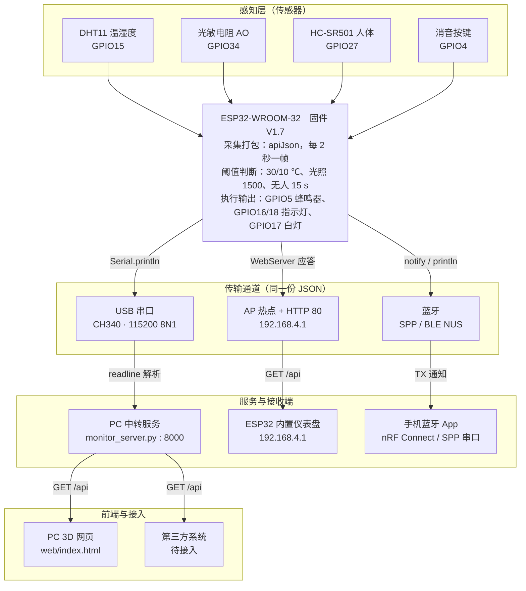
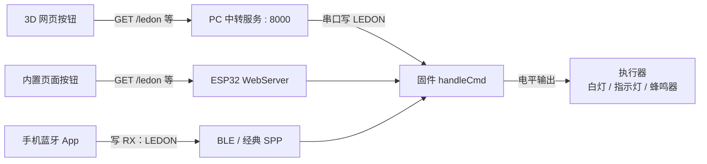

# 居家养老环境监测系统 架构图

图 1 为数据上报链路，自上而下依次是感知层、控制层、传输通道、服务与接收端、前端与接入；图 2 为控制指令的回程路径。

## 图 1　数据上报链路



## 图 2　控制指令回程



## 通道对照

| 通道 | 传输方式 | 访问地址 / 名称 | 接收端 | 适用场景 |
|---|---|---|---|---|
| 一 | USB 串口 | COM11，115200 8N1 | PC 中转服务 | 电脑上位机，稳定低延迟 |
| 二 | ESP32 AP + HTTP | http://192.168.4.1/api | ESP32 内置页面 | 手机现场查看，不依赖电脑 |
| 三 | PC 中转 HTTP | http://127.0.0.1:8000/api | 3D 网页、第三方系统 | 标准 HTTP 接入 |
| 四 | 蓝牙 | ESP32_Care / ESP32_Care-BLE | 手机 App | 无网络、短距离直连 |

## 数据帧

四条通道内容一致，单行 JSON，每 2 秒一帧：

```json
{"temp":25.8,"hum":52,"light":1535,"pir":0,"idle":12,"level":1,"muted":0,"auto":1,"count":3}
```

`light` 数值越大越暗；`temp` 或 `hum` 为 -99 表示 DHT11 读取失败。

## 控制回程

文本指令以换行符结尾，串口、经典蓝牙与 BLE 共用；HTTP 侧对应 `/ledon`、`/ledoff`、`/auto`、`/beep`、`/mute`、`/unmute` 六个 GET 路由，PC 服务返回 `{"ok":1}`。
